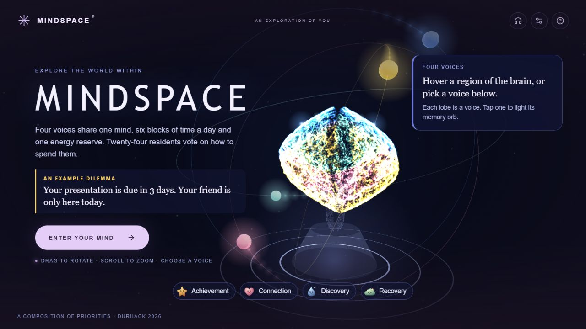
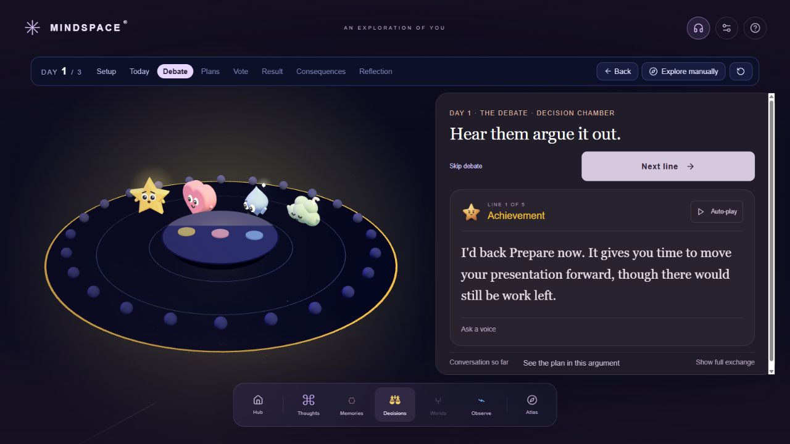
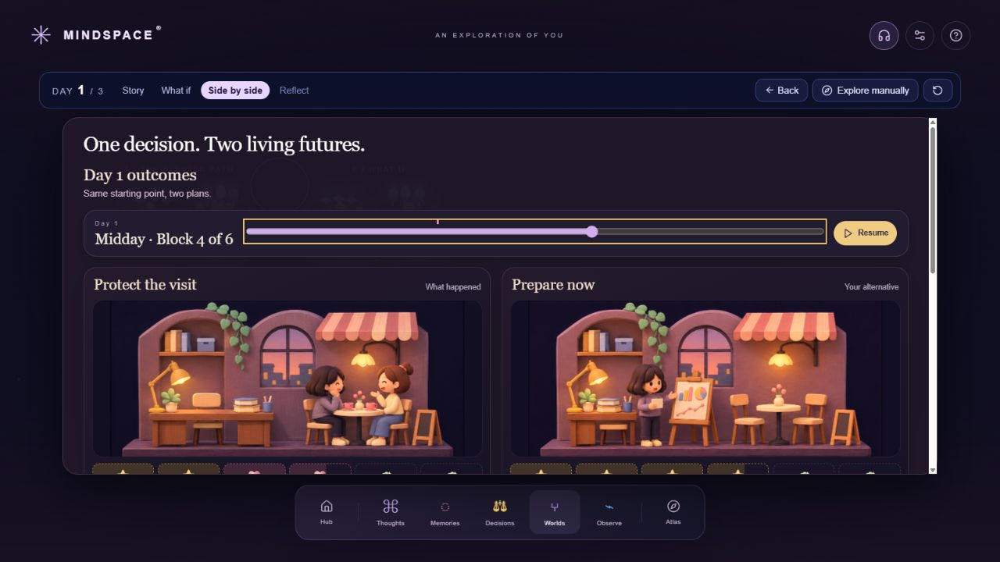

# MINDSPACE

### A small world for the decisions that feel big.

**Turn a personal dilemma into a living inner world. Hear your competing priorities, shape the choices, and watch two possible paths unfold.**

Built for **DurHack 2026**, around the theme of **composition**.



## The problem

“My presentation is due soon, but my friend leaves tomorrow.”

You can know everything on your to-do list and still struggle to choose. Work matters. So do relationships, curiosity and rest. Those needs compete for the same time, and the cost of a choice can be difficult to picture until afterwards.

MINDSPACE makes that conflict tangible. A thought becomes a world with four voices, a debate, an election and visible consequences. You can explore what a different choice would change before taking that perspective back into your own day.

**The aim: help you understand a trade-off well enough to make your own choice.**

## Your mind becomes the new world

Four animated characters give the competing priorities a voice:

| Voice | What it asks |
| --- | --- |
| ⭐ **Achievement** | How do we make progress on what matters? |
| 💗 **Connection** | Who do we want to make time for? |
| 💧 **Discovery** | Could a different approach help? |
| ☁️ **Recovery** | What do we need to keep going? |

The brain is an artistic setting for this conflict. Its pathways, floating districts and characters turn an internal conversation into something you can see and interact with.

### Hear the disagreement

The voices explain their priorities in everyday language. Ask them why they care or what their preferred plan gives up. A speaking persona receives the stage spotlight, so the conversation and the world stay connected.



### Compose a choice

1. **Release a thought.** Enter a dilemma and confirm the relevant details.
2. **Hear the debate.** Explore the competing needs behind the options.
3. **Shape the plans.** Adjust the daily time blocks in the presentation demo, or confirm complete-plan durations in the other scenarios.
4. **Watch the election.** Twenty-four residents vote using individual preference weights. Inspect their ballots to understand the result.
5. **Replay the day.** Picture sequences show the chosen activities, with playback and scrubbing.
6. **Open Parallel Worlds.** Compare the chosen plan with an alternative and see where the paths diverge.

### See the trade-off

Both paths share the same confirmed starting context. The artwork changes with the activities: preparing a presentation, meeting a friend, trying a new approach or resting. The comparison exposes the consequences behind the appealing name of a plan.



## Why composition?

The challenge is to arrange competing needs into a day that works. Achievement, Connection, Discovery and Recovery each contribute something valuable; a plan composes them within limited time.

That same idea runs through the implementation. **One decision state drives the dialogue, ballots, scene changes and musical layers.** Visuals and sound express what happened in the simulation. The Observatory lets you inspect the mathematics beneath the experience.

## More than one dilemma

The current catalogue covers **16 situations**, including family time, coursework, friendships, team boundaries and everyday decisions. Matching uses local authored rules, followed by confirmation of the relevant facts.

<details>
<summary><strong>Example thoughts to try</strong></summary>

| Situation | Paste into Thought Headquarters |
| --- | --- |
| Presentation and a visit | My presentation is due soon and my friend leaves tomorrow. |
| Family time | I want to spend time with family. |
| Family and a deadline | A family occasion overlaps my project deadline. |
| Exam and going out | My friend invited me out but I have an exam tomorrow. |
| Shift and coursework | An extra shift clashes with my coursework. |
| Hackathon scope | Should our hackathon team add a feature before judging? |
| Study format | Should I study alone or join my study group? |
| Learning a tool | Should I learn a new tool for this project? |
| Helping someone move | My friend needs help moving but I have work to finish. |
| Going out when drained | I feel drained but my friend invited me out. |
| Team boundaries | My teammate wants me to take their work too. |
| Scrolling break | I’m taking a scrolling break and deciding what to do next. |
| Joining a club | I want to join a club but my week is packed. |
| Housemate conversation | My housemate leaves the kitchen messy and I want to talk. |
| Polishing and submitting | My assignment is finished but I keep polishing instead of submitting. |
| Two invitations | Two friends invited me to different events on the same evening. |

</details>

## The technology

| Layer | Stack | What it does |
| --- | --- | --- |
| Application | **React 19 + TypeScript** | Guided journey, editable plans and typed state transitions. |
| 3D world | **Three.js + React Three Fiber + Drei** | Brain entrance, districts, animated personas, camera movement and election stage. |
| Animation | **Motion + CSS** | Scene transitions, image crossfades, character cues and timeline playback. |
| Scene artwork | **Local PNG illustrations** | Clay-style settings and activity frames, animated in the browser. |
| Decision engine | **Pure TypeScript** | Scenario rules, feasibility checks, weighted voting and counterfactual replay. |
| Sound | **Native Web Audio API** | Synthesized musical layers that respond to the simulation; no recorded soundtrack required. |
| Tooling | **Vite + Vitest** | Local development, production bundles and automated checks. |
| Hosting configuration | **Cloudflare Workers Static Assets** | Serves the built SPA with client-side routing fallback. |

### What makes the model inspectable

- **Individual votes:** each resident scores feasible plans against their own four preference weights; the highest score receives their vote. Equal scores use stable plan order.
- **Shared context:** scenario dialogue, ballots and comparison artwork use the same confirmed facts and timings. An unavailable option cannot receive votes.
- **Recorded outcomes:** the multi-day presentation demo resolves each day once. Its alternative path replays from a shared starting state, preserving the original history.
- **Explainable limits:** scores and preferences are authored simulation parameters. The brain is a metaphor; outcomes are illustrative, not measured psychology or real-world predictions. The app runs without an LLM or external AI service.

Thoughts stay in browser memory. No account, database or API key is needed; refreshing starts a fresh session.

## Run locally

Use **Node.js 22.12+** and npm.

```bash
npm ci
npm run dev
```

Open **http://localhost:5173**. For a quick demo, enter the presentation-and-visit thought above, confirm the setup, follow the debate and vote, then explore the alternative in Parallel Worlds.

The full world uses WebGL2. An illustrated mode is available, alongside reduced-motion controls. Sound is optional and requires a browser interaction to enable.

```bash
npm run typecheck   # TypeScript checks
npm test            # Vitest suite
npm run build       # Production build in dist/
npm run preview     # Preview at http://localhost:4173
```

**132 tests across 13 files** cover scenario routing, context alignment, voting, lifecycle rules, persona dialogue, artwork coverage, playback, memory and counterfactual behavior. The 16 example inputs have also been exercised through the local browser journey.

### Cloudflare

The repository includes `wrangler.jsonc` for static SPA hosting. Build before previewing or deploying:

```bash
npm run build
npm run cf:dev      # Local Cloudflare preview at http://localhost:8787
```

To publish using your Cloudflare account:

```bash
npx wrangler login
npm run deploy
```

## Inside the repository

| Location | Responsibility |
| --- | --- |
| [`src/MindScene.tsx`](src/MindScene.tsx) | 3D world and animated stage. |
| [`src/GuidedJourney.tsx`](src/GuidedJourney.tsx), [`src/journey.ts`](src/journey.ts) | Multi-day demo and journey state machine. |
| [`src/ScenarioFlow.tsx`](src/ScenarioFlow.tsx), [`src/scenarioJourneyModel.ts`](src/scenarioJourneyModel.ts) | Scenario-specific journey and 24-resident election. |
| [`src/engine/`](src/engine/) | Authored catalogue, matching, rules and feasibility. |
| [`src/simulation.ts`](src/simulation.ts) | Daily allocation model, forecasts and resolution. |
| [`src/ParallelWorlds.tsx`](src/ParallelWorlds.tsx), [`src/ScenarioPlayback.tsx`](src/ScenarioPlayback.tsx) | Side-by-side alternatives and scene playback. |
| [`src/audio.ts`](src/audio.ts) | Browser-generated musical composition. |
| [`public/art/`](public/art/) | Brain and scenario illustration assets. |
| [`tests/`](tests/) | Automated checks. |

All screenshots above were captured from the running app.
